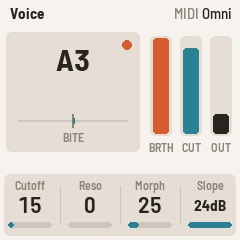
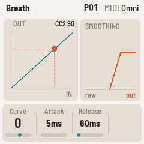
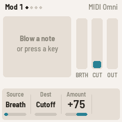

# FM-1 Windsynth

Custom firmware that turns the **M-VAVE FM-1** into a synthesizer for **any MIDI wind controller**
(EWI, NuRAD, Aerophone, Sylphyo and the rest), with voices taken from Mutable Instruments Plaits.
It runs in the browser first, as the firmware's own C code compiled to WebAssembly, and then on the
FM-1 itself.

> **Status: in development (0.0.x).** It plays: notes, breath, bite and glide from any windsynth
> drive a Plaits voice (Classic or FM), with 64 presets, a reverb and a delay, in the browser and on
> the FM-1. Nothing is released yet. The plan is in [docs/PLAN.md](docs/PLAN.md).

  

## Playing

Plug in your windsynth (USB, or the FM-1's MIDI jack) and blow. It listens on every channel by
default. Last note wins: overlapping notes play legato, without a new attack, and letting one go
returns to the one still held. The FM-1's own keys play too, every key its printed note from F3, as if
blown at the **Key breath** level.

| Control | Default | Options |
| --- | --- | --- |
| Breath | CC2, to filter cutoff (Mod 1: Breath → Cutoff, +75) | Aftertouch or any CC as the source; a curve; the Mod slots also send it to amp, resonance or morph |
| Bite | Pitch bend, ±2 semitones | 0 to 12 semitones |
| Glide | CC5 sets glide time, up to 400 ms | Another CC, or none; how long a glide the CC reaches at full (CC depth, up to 2 s); glide on every note or legato only |

The screen shows the note (with its offset in cents while you bend), the bite, and bars for breath,
cutoff and output.

## Pages

A page button opens its page, and pressed again its next one; the four knobs set its four values. **EDIT** and the **SELECT** knob
step through every page.

| Button | Page | Knobs |
| --- | --- | --- |
| HOME | Voice | Cutoff, Resonance, Morph (Classic: the waveform, a saw up to 25, a square at 50, then a pulse that narrows and widens again, with a sub-octave below 20 and above 80; FM: the feedback, none at 50), Slope (12 or 24 dB) |
| HOME again | Engine | Engine (Classic or FM; also the ALGORITHM knob), Ratio (FM's modulator, 0.5 to 16 times the note), Index (how much FM) |
| ENV | Breath | Source (a CC, or aftertouch), Curve, Attack, Release |
| LFO | Pitch | Bend range, Glide source, Glide time, Glide mode (always or legato) |
| LFO again | Pitch 2 | CC depth: the glide time the glide CC reaches at full (400 ms by default, up to 2 s) |
| SEL | Mod 1–4 (press again for the next) | Source (breath, bite, mod wheel, pressure, velocity), Destination (cutoff, resonance, amp, morph, timbre: FM's index), Amount (−100 to +100) |
| SEQ | Keys | Key breath, Octave |
| GLO | Setup | Transpose, Tune, MIDI channel (Omni by default), Theme (Light or Dark); the version |
| FX | Reverb | Type (Cloud, Hall, Plate, Room, Shimmer), Mix, Decay (0.2 s to 60 s), Tone |
| FX again | Reverb 2 | Pre-delay (up to 500 ms), Size, Mod (how much the reverb moves; on Shimmer, Shimmer: how much of the tail climbs), Low end (the bass's decay, shorter or longer) |
| FX again | Delay | Mode (Digital, Tape, Analog, Ping-pong), Mix, Time (20 ms to 2 s; Ping-pong to 1.1 s), Feedback |

**OCT−** / **OCT+** move the panel's keys by octaves.

## Effects

The delay feeds the reverb, and both are stereo out. Mix works the same on each: at 0 the effect is
off, at 50 you hear the dry sound and the effect at full level, and at 100 only the effect. Both start
at 0, so the init sound is dry, and a preset keeps its effects.

The reverb is one tank with five voicings. **Cloud** is the big ambient one, after Strymon's BigSky
Cloud: a long chain of moving diffusers in front of a large loop, so notes bloom rather than echo.
**Hall**, **Plate** and **Room** are smaller and plainer. **Shimmer** is Cloud whose tail goes through
an octave-up pitch shifter and back into its input, so it climbs an octave at a time, as Valhalla's
and BigSky's shimmers do; on Reverb 2 its Mod knob becomes Shimmer, how much climbs. Decay shows the reverb time. The delay's **Tape** mode wobbles and darkens
its repeats, **Analog** is darker still, and **Ping-pong** echoes left at Time and right at twice it.
Time changes glide, like a tape echo. Feedback at 100 repeats for ever, saturating instead of
growing.

## Presets

There are 64 presets, P01 to P64, and every one starts as the init sound. Turn **PRESETS** to play
another; the header shows which, with a `*` once you've changed its sound. To keep a sound, press
**SAVE**: the header asks "SAVE TO P12". Turn **PRESETS** to pick another slot if you like, then
press **SAVE** again (any other button leaves the presets alone). What you're playing, edits
included, is also kept by itself a few seconds after you stop, so it comes back after a restart.

A preset holds the sound: the Voice, Pitch and Mod pages, and Attack and Release. Your rig's settings
stay put when you change presets: breath source and curve, the glide CC and its depth, the Keys page and Setup.
Hold **SAVE** for 1.5 s, then press it again, for the init sound (the preset slot is untouched until
you save).

## In rough order

- 0.0.1: the fork of FiMba-1, renamed.
- 0.0.2: Plaits' VA-VCF voice inside, bit-exact with upstream Plaits.
- 0.0.3: playable: breath, bite, glide and the mod matrix, from any windsynth, with its own pages and
  screen. The kalimba is gone. The browser version picks a MIDI input and shows what it hears.
- 0.0.4: the init sound is a single saw with breath on the cutoff only.
- 0.0.5: 64 presets, picked with PRESETS and saved with SAVE.
- 0.0.6: a second engine, Plaits' 2-op FM, through the same filter so breath works the same way.
- 0.0.7: a reverb (Cloud, Hall, Plate, Room, Shimmer) and a delay (Digital, Tape, Analog, Ping-pong).
- 0.0.8: CC depth, the longest glide the glide CC reaches.
- 0.0.9: Shimmer rebuilt: the tail climbs in octaves, with a Shimmer amount.

## Building and testing

See [BUILDING.md](BUILDING.md). In short: `python3 tools/build.py` builds the FM-1 package,
`web/emu/build.sh` builds the browser version, and `tests/run_tests.sh` runs everything.

## Credits

FM-1 Windsynth is a fork of [FiMba-1](https://github.com/jadamsowers/fm1-fimba) by Adam Sowers,
which grew from [FoMni](https://github.com/charlesvestal/fm1-fomni) and
[X0X](https://github.com/charlesvestal/fm1-x0x) by Charles Vestal, both built on
[Felucca](https://github.com/hugelton/Felucca) by Leo Kuroshita (Hügelton Instruments). The voices
come from [Plaits](https://github.com/pichenettes/eurorack) by Émilie Gillet (MIT). FiMba's
original README, which documents the kalimba this started from, is in
[docs/FIMBA-README.md](docs/FIMBA-README.md).

Licensing: GPL-3.0-only; see [LICENSING.md](LICENSING.md). Not affiliated with M-VAVE.
